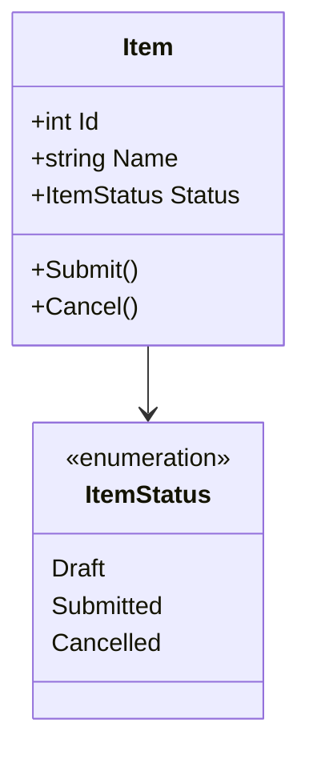
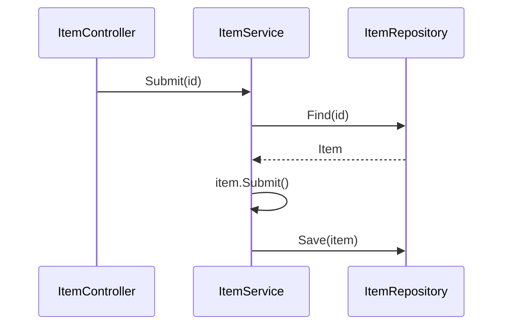
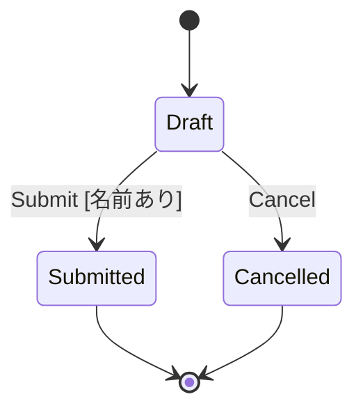

# SAMPLE 詳細設計

## 前提

<!-- 対応する基本設計の節を :ref で参照する（書き写さない） -->

- 画面遷移・処理：:ref[../basic/sample.md#画面遷移]、:ref[../basic/sample.md#処理]
- データ：:ref[../basic/sample.md#データ]

## 画面

<!-- 画面イメージは基本設計のモックが正。ここでは同じモックを埋め込み（表示だけ）、項目の詳細を書く -->

::mock[sample/index.html]

| 項目 | testid | 種類 | 型・桁 | 必須 | 初期値 | 取得元・送信先 | 入力チェック・エラー文言 |
|---|---|---|---|---|---|---|---|
| 名前 | `name` | テキスト | 文字列 50 | ○ | 空 | `POST /drafts` の `name` → `Item.Name` | 空・51 文字以上：「入力内容を確認してください」 |
| 一覧 | `items` | 一覧 | — | — | — | `GET /items` | — |
| 確定 | `submit` | ボタン | — | — | — | `POST /items` | 失敗：`submit-error` にサーバのメッセージ |

## 構造

## 振る舞い

参照：:ref[../basic/sample.md#処理]

## 状態

<!-- 単体テストの単位（クラス/関数）の状態図。matrix で単体テストのマトリクスになる -->

- 不正遷移（状態×イベント表の ×）は例外を送出する
