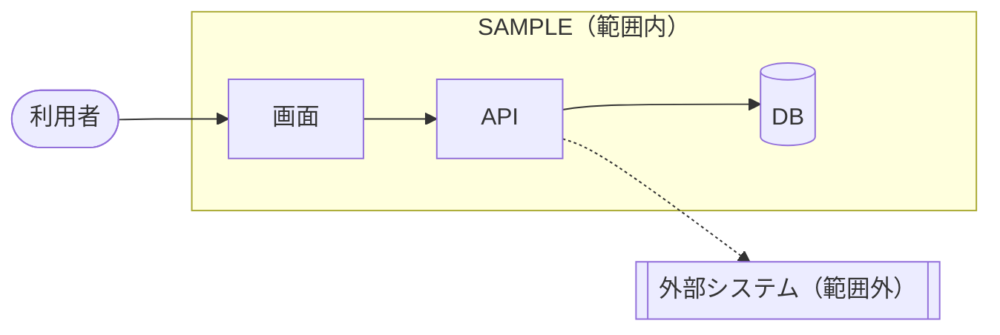
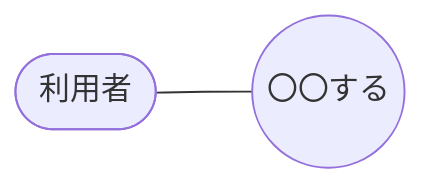

# SAMPLE 要件定義

<!-- 図で表す。文章は箇条書き・表の最小限にする。SAMPLE は文書ID（英大文字）に置き換える -->

## 目的

- 誰の・何の困りごとを解決するか（1〜2行）
- 成功の判定基準（測れる形）：〇〇を △△ → □□ にする

## 現状 (As-Is)

<!-- 今のやり方。課題のあるノードは class X issue で印を付ける -->

## あるべき姿 (To-Be)

<!-- As-Is と同じノードIDを使う。差分（ギャップ）ごとに %% req: <ノードID または 元->先> <要件ID> を書く -->

## スコープ

<!-- システム境界を subgraph で表す。範囲外も明示する -->

## ユースケース

## 要件一覧

| ID | 種別 | 要件 | 優先度 |
|---|---|---|---|
| REQ-001 | 機能 | 利用者が画面で〇〇を入力できる | 高 |

## 受入基準

| 要件 | 受入基準 |
|---|---|
| REQ-001 | 〇〇を入力して確定すると △△ になる |
